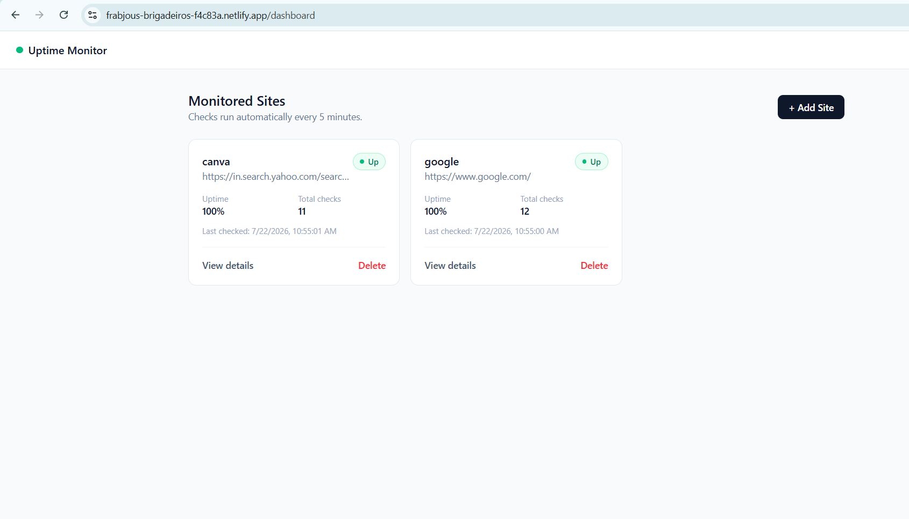
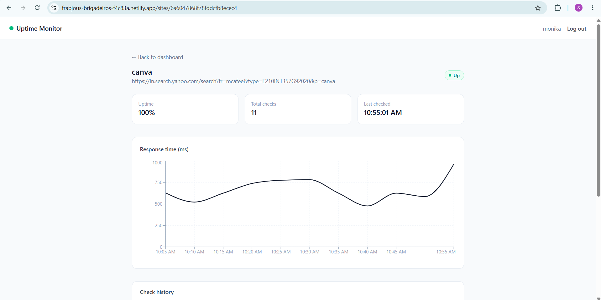

# Uptime & Health Monitor (MERN)

A full-stack website/API monitoring platform. Add URLs, and a scheduled
background job checks them every 5 minutes, logging status, HTTP code,
and response time — with email alerts on up/down transitions.

## 🔗 Live Demo
- **App**: https://uptime-monitor.netlify.app/
- **API**: https://uptimemonitor-1.onrender.com

> Note: the backend runs on Render's free tier, which sleeps after ~15
> minutes of inactivity. The first request after a period of inactivity
> may take 30–60 seconds to respond while the server wakes up.

## Screenshots
 |  |

## Stack
- **Frontend**: React (Vite) + Tailwind CSS + Recharts + React Router
- **Backend**: Node.js + Express + node-cron + Nodemailer
- **Database**: MongoDB (Atlas)
- **Deployment**: Netlify (frontend) · Render (backend) · MongoDB Atlas (database)

## Features
- JWT authentication (signup / login), passwords hashed with bcrypt
- Add, view, and delete monitored sites — scoped per user
- Scheduled background health checks every 5 minutes via `node-cron`
- Tracks HTTP status code, response time, and up/down state per check
- Uptime percentage calculated from check history
- Email alerts sent only on status **transitions** (up→down / down→up),
  not on every failed check
- Response-time history chart (Recharts) per monitored site
- External scheduler support (`/api/ping-check`) to keep checks reliable
  on free-tier hosting

## Project structure
```
uptime-monitor/
├── backend/    # Express API + cron job
└── frontend/   # React dashboard
```

## Local setup

### 1. Backend
```bash
cd backend
npm install
cp .env.example .env   # then fill in real values
npm run dev
```

Required `.env` values:
| Variable | Description |
|---|---|
| `MONGO_URI` | MongoDB Atlas connection string |
| `JWT_SECRET` | any random long string |
| `EMAIL_USER` | Gmail address used to send alerts |
| `EMAIL_APP_PASSWORD` | Gmail **App Password** (not your real password) — generate at https://myaccount.google.com/apppasswords |

### 2. Frontend
```bash
cd frontend
npm install
cp .env.example .env   # points at your local backend by default
npm run dev
```

Visit `http://localhost:5173`.

## How the monitoring works
1. You add a site (name + URL) from the dashboard.
2. Every 5 minutes, `node-cron` pings every stored site, records status/HTTP
   code/response time, and keeps the last 100 checks per site.
3. If a site's status **changes** (up→down or down→up), you get exactly
   one email alert — not one per failed check.
4. The dashboard polls the API every 60s so status stays reasonably fresh
   without a manual refresh.

## Known limitation: free-tier hosting
Render's free tier spins the server down after ~15 minutes of inactivity.
When that happens, the in-process `node-cron` scheduler stops running until
something wakes the server back up — so checks can be delayed.

**Mitigation**: an external scheduler like [cron-job.org](https://cron-job.org)
can hit `GET /api/ping-check` every 5 minutes to both trigger a real check
cycle and keep the server awake. This is a deliberate design accommodation
for free-tier PaaS hosting, documented here rather than hidden.

## Deployment
- **Database**: MongoDB Atlas (free M0 cluster)
- **Backend**: Render (Node web service, root dir `backend`, build `npm install`, start `npm start`)
- **Frontend**: Netlify (root dir `frontend`, build `npm run build`, publish dir `dist`)

Environment variables are set directly in each platform's dashboard
(never committed to the repo — see `.gitignore`).

## Resume description
> **Uptime & Health Monitor (MERN + Cloud + DevOps)** — Built and deployed
> a full-stack website/API monitoring platform. Implements JWT auth,
> scheduled background health checks via node-cron, response-time
> tracking, and email alerting limited to state transitions. Deployed
> across three cloud services (Netlify, Render, MongoDB Atlas) and
> documented a real free-tier hosting constraint around scheduled job
> reliability, with an external-scheduler mitigation.
